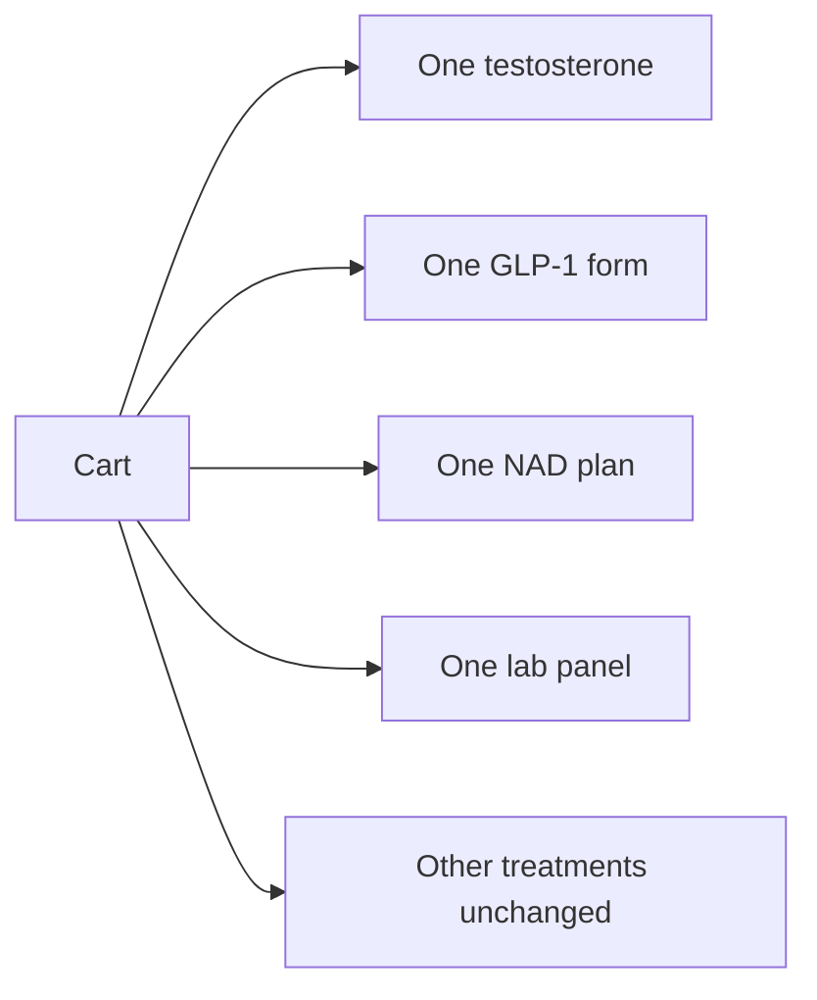

# Cart combination rules

The cart in [`components/cart/CartProvider.tsx`](components/cart/CartProvider.tsx) currently merges by line id and increments quantity, with no combination checks. Semaglutide injectable and sublingual are different line ids (`slug::variant`), and Complete vs Advanced labs are different products, so both can sit in the same bag. Quantity steppers in [`components/cart/SideCart.tsx`](components/cart/SideCart.tsx) and [`app/checkout/CheckoutForm.tsx`](app/checkout/CheckoutForm.tsx) can raise any line above 1.

Add one pure rules module and use it everywhere an item enters the cart or checkout.

## Allowed cart

These three can share a cart. Each slot holds one line at quantity 1:

- **Testosterone:** `men-trt-testosterone-cypionate`, `men-trt-testosterone-cream`, `women-hrt-testosterone-cream`, `women-hrt-testosterone-injection-low-dose`
- **One weight-loss medication:** `weight-loss-semaglutide` or `weight-loss-tirzepatide`, and only one form (injectable or sublingual)
- **One NAD plan:** `nad-injectable`, `longevity-nad`, and `longevity-nad-nasal-spray` share one slot (injectable and the unlisted nasal plan cannot both be ordered; the two injectable slugs share a checkout product id)

**Labs:** one panel per order. `labs-complete-panel` and `labs-advance-panel` share one slot, including the Men and Women variants, at quantity 1.

Other treatments (sexual health, sermorelin, glutathione, estrogen, enclomiphene, women’s hormone therapy) stay addable and keep the current quantity controls. Enclomiphene is not treated as testosterone.

## Enforcement

New [`lib/cart/rules.ts`](lib/cart/rules.ts) looks up the slug in [`lib/content/products.ts`](lib/content/products.ts) and returns a patient-facing reason when a proposed cart is invalid:

- A second testosterone product: already has a testosterone treatment
- Semaglutide with tirzepatide, or both forms of the same drug: already has a weight-loss medication
- A second NAD product: already has an NAD plan
- Complete and Advanced together, or both gender variants: already has a lab panel
- Quantity above 1 on any of those slots: limited to one per order

[`CartProvider`](components/cart/CartProvider.tsx) checks this inside `addItem` and `setQuantity`. A rejected add does not change the bag. It opens the cart and stores the reason. Re-adding the same capped line does not increase quantity. The increase button is disabled at the cap in the side cart and on checkout.

[`app/api/cart/checkout/route.ts`](app/api/cart/checkout/route.ts) runs the same check before the GenHealth handoff and returns 422 with that reason. [`CheckoutForm`](app/checkout/CheckoutForm.tsx) blocks submit the same way, so the on-site checkout cannot continue with a bag that breaks the rules. URL seeding that conflicts with the current bag is skipped and the reason is shown.

## Verification

Exercise the shop in the browser: testosterone plus one GLP-1 form plus one NAD plan succeeds; the other GLP-1, the other form, a second NAD plan, a second testosterone product, and the other lab panel are refused with the cart message and quantity stays at 1. Confirm an unrelated product such as tadalafil can still be added.