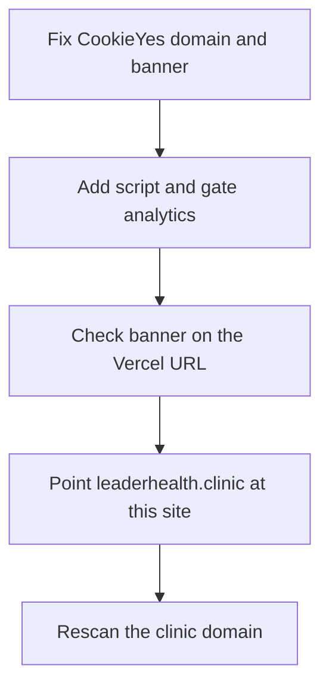

# CookieYes before the domain change

Do the install and the consent check **before** DNS moves. Rescan **after**.

`www.myleaderhealth.com` is the address on the CookieYes account in your screenshot, and that scan found 1 page and 0 cookies. This website is [leaderhealth.clinic](https://leaderhealth.clinic), still on Framer until the cutover in [switch_clinic_domain_25595029.plan.md](.cursor/plans/switch_clinic_domain_25595029.plan.md). Live traffic for this app is [https://leaderhealth-platform.vercel.app](https://leaderhealth-platform.vercel.app). `myleaderhealth.com` is the email domain (`privacy@`, `help@`), not the site CookieYes should scan.

If the banner waits until after DNS, the first clinic visitors hit [components/analytics/Analytics.tsx](components/analytics/Analytics.tsx) with PostHog and GA4 already loading and no banner. The cookies policy already promises an accept/decline banner and a footer Cookie Preferences control. The Pro trial also expires in about 13 days; the banner stops when the trial ends unless the plan is paid.

The banner stays the GDPR opt-in you already selected, for every visitor. Analytics stays off until Accept. The existing [/legal/do-not-sell](lib/content/published-legal.ts) page and Global Privacy Control still record an opt-out. US visitors do not get a separate opt-out banner.

This install covers this Next app only. The quiz (`products.leaderhealth.clinic`) and the patient portal (`myportal.leaderhealth.clinic`) need their own CookieYes sites if they set non-essential cookies.

## 1. You, in CookieYes, before any code

1. Change the connected website from `www.myleaderhealth.com` to `https://leaderhealth.clinic`. Add `https://leaderhealth-platform.vercel.app` as the staging site (included on Pro). The same install script then runs on the Vercel URL before DNS.
2. Leave **Consent template: GDPR** and **Geo-target: Worldwide**. Do not switch US visitors to the US State Laws opt-out banner.
3. Turn on **Support Google Consent Mode**. The default must be denied before any Google tag runs.
4. Turn on **Respect Global Privacy Control**. It is a Pro toggle. If it is hidden on the GDPR template and only appears under US State Laws, turn on the combined template but keep the GDPR accept/decline banner for every country, including the United States. A browser sending GPC should be treated as rejecting Analytics and Advertisement.
5. In the banner content, set the cookie policy link to `/legal/cookies`.
6. Turn the floating revisit button **off**. The policy names a footer link, and the site already has its own corner controls.
7. Leave the consent log on.
8. Open **Get installation code** and copy the website key from `https://cdn-cookieyes.com/client_data/<key>/script.js`. That key is public. It will be `NEXT_PUBLIC_COOKIEYES_CLIENT_ID`.
9. Do not scan `leaderhealth.clinic` yet. That host is still Framer, so the scan would list Framer cookies. Scan the Vercel staging URL after the script is deployed.

In **Cookie Manager**, after that staging scan:

- CookieYes consent cookie, affiliate cookies (`lh_aff`, `lh_aff_campaign`), and any cart or session cookie: **Necessary**. Do not mark them as sell or share.
- PostHog and Google Analytics cookies: **Analytics**. Turn on **Sell or share personal data** for Analytics and Advertisement so an opt-out or a GPC signal shuts them off.
- Publish. Enable removal of rejected-category cookies on opt-out, so `_ga` and PostHog cookies are cleared when someone declines after previously accepting.

## 2. In this repo, before DNS

Asking to execute this plan builds this section. It does not log into CookieYes or change DNS.

- Put the CookieYes script in [app/layout.tsx](app/layout.tsx) so it is the first script, ahead of `<Analytics />`. CookieYes's Next.js guide uses `next/script` with `strategy="beforeInteractive"`. If this Next 16 build adds `crossorigin` to that tag, use a plain `<script>` in `<head>` instead. Their docs say `crossorigin` makes the banner serve a stale file. Read the script from `NEXT_PUBLIC_COOKIEYES_CLIENT_ID`. No key means no banner and no analytics.
- Change [components/analytics/Analytics.tsx](components/analytics/Analytics.tsx) so PostHog and GA4 load only when CookieYes reports the `analytics` category accepted (`cookieyes_banner_load`, then `cookieyes_consent_update` / `getCkyConsent()`). On reject, call `posthog.opt_out_capturing()` and set `window['ga-disable-<id>']`. `/checkout`, `/checkout/success`, and `/admin` stay excluded even if the visitor accepted. Do not send cookieless GA pings before consent.
- In [components/Footer.tsx](components/Footer.tsx), add a **Cookie Preferences** button with class `cky-banner-element`, next to the existing legal links. That class is what reopens the banner. Use a `<button>`, not a Next.js `Link`.
- On [/legal/do-not-sell](app/legal/[slug]/page.tsx), under "How to opt out", add a button that opens the same preference center so the visitor can turn Analytics and Advertisement off. Keep the email path for an authorized agent and for "limit sensitive personal information." CookieYes does not handle those. If the dashboard offers a one-click Do Not Sell snippet that works without switching the banner to US opt-out, use that snippet instead of the preference button.
- In CookieYes, disable the banner on `/checkout` and `/admin` (Pro: disable on specific pages). The consent cookie can already exist. The banner should not sit on a health-screening form.
- Add the env var to [.env.example](.env.example). Set it on Vercel Production, then redeploy with the build cache off. `NEXT_PUBLIC_*` is baked in at build time.
- After GPC is confirmed, update the "we are implementing GPC / until live" sentences in [lib/content/cookies-policy.ts](lib/content/cookies-policy.ts) and the Do Not Sell page in [lib/content/published-legal.ts](lib/content/published-legal.ts). In the cookies policy, name Google Analytics 4 and PostHog as the analytics tools on public pages, and state that checkout and admin do not load them.

## 3. Verify on the Vercel URL, still before DNS

Private window on `https://leaderhealth-platform.vercel.app`.

- First visit shows Accept and Decline. Reject: no PostHog `$pageview`, no `gtag` request, no `_ga` cookie.
- Accept: PostHog Live shows `site` = `cursor`, and GA4 Realtime shows the page. Cookie Preferences reopens the banner. Decline after Accept stops further hits.
- `/legal/do-not-sell` opt-out turns analytics off. `/checkout` loads no PostHog or GA.
- A browser with GPC on is treated as declined without clicking Reject.

## 4. After the domain cutover

No second install. When `https://leaderhealth.clinic` serves this deployment:

- Rescan that host in CookieYes, categorize anything new, and publish.
- Repeat the private-window check on `https://leaderhealth.clinic`.
- Unpublish Framer or remove its tags, as in the analytics plan, so the old site cannot keep setting cookies.
- `www.leaderhealth.clinic` should redirect to the apex. CookieYes should list the apex as the site.
