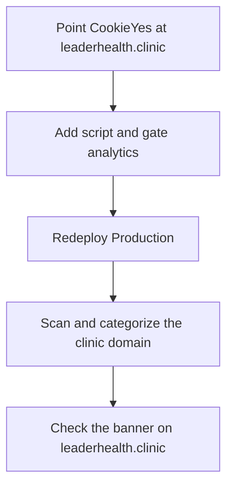

# CookieYes on the live clinic domain

The domain cutover is done. `https://leaderhealth.clinic` is this app, so CookieYes is installed, scanned, and checked there. There is no separate "before DNS" pass.

CookieYes is connected to `https://leaderhealth.clinic`. On November 9 the dashboard shows **Pro (Trial), 14 days left, 300,000 pageviews**. General settings and Support GCM are done. Still to finish in CookieYes: the Content tab (cookie policy link and floating button), Global Privacy Control, and hiding the banner on `/checkout` and `/admin`. The banner stays inactive until the install snippet is deployed. A scan on November 3 found 26 pages, 3 cookies, and 2 categories, before that snippet existed. Categorize those cookies, then scan again after the snippet is deployed.

PostHog and GA4 already load on public pages from [components/analytics/Analytics.tsx](components/analytics/Analytics.tsx), with no banner. The cookies policy already promises an accept/decline banner and a footer Cookie Preferences control. The trial on `www.myleaderhealth.com` expires in 1 day. Buy **Pro monthly ($25/domain)** after the connected site is `leaderhealth.clinic`. Do not buy Ultimate, and do not pay for `myleaderhealth.com`.

Pro is the cheapest plan that includes the two features this install uses: Global Privacy Control, and turning the banner off on `/checkout` and `/admin`. Ultimate ($55) adds scan-behind-login, removing the "Powered by CookieYes" mark, a custom logo, and a custom floating button. This site does not use those. Patient pages stay off the scanner, the floating button stays off, and the footer Cookie Preferences link works on Pro. A 4,000-page scan and 300,000 pageviews a month cover this marketing site. The quiz and the patient portal are separate hosts and are not part of this subscription.

The banner stays the GDPR opt-in already selected, for every visitor. Analytics stays off until Accept. The existing [/legal/do-not-sell](lib/content/published-legal.ts) page and Global Privacy Control still record an opt-out. US visitors do not get a separate opt-out banner.

This install covers this Next app only. The quiz (`products.leaderhealth.clinic`) and the patient portal (`myportal.leaderhealth.clinic`) need their own CookieYes sites if they set non-essential cookies. `https://leaderhealth-platform.vercel.app` can stay attached in Vercel; it does not need its own CookieYes site. Optional: add it as the Pro staging site if you still want the banner there.

## 1. You, in CookieYes, before any code

1. Change the connected website from `www.myleaderhealth.com` to `https://leaderhealth.clinic` before paying. The upgrade screen bills whichever domain is connected, and CookieYes charges per domain. Use the apex. `www.leaderhealth.clinic` should already redirect to it. Then buy **Pro, monthly**. Annual is the same Pro plan with two months free, only after the domain shown is `leaderhealth.clinic`. Do not scan yet. The setup screen for `https://leaderhealth.clinic` should be English, **Banner** layout (not Box), and Light. That screen only sets appearance. Leave colors and wording for later. Stay on the GDPR template.
2. On **Cookie Banner → General**, leave **Consent template: GDPR**, **Geo-target: Worldwide**, and consent expiration at **365** days. Leave **Reload page on consent action** off. Leave these three toggles off: **Support IAB TCF v2.4**, **Support Google’s Additional Consent Mode**, and **Enable Google’s Advertiser Consent Mode**. Those are for ad vendors, not for GA4. Do not switch US visitors to the US State Laws opt-out banner.
3. Turn on **Support GCM** under the top-nav **Advanced Settings**. Leave **Allow Google tags to fire before consent** off, so Google gets nothing until Accept. The default must be denied before any Google tag runs.
4. Done. **Respect Global Privacy Control** is on. A browser sending GPC should be treated as rejecting Analytics and Advertisement.
5. Done. The banner cookie-policy link is `https://leaderhealth.clinic/legal/cookies`.
6. Done. The floating revisit button is off. The site footer will carry Cookie Preferences instead.
7. Leave the consent log on.
8. The install snippet was copied from the CookieYes dialog the site owner pasted. The key is the path segment in that script URL, not a separate secret. `NEXT_PUBLIC_COOKIEYES_CLIENT_ID` is `7bf225c1f6aa4e3c778ade224a19a718`. The script is `https://cdn-cookieyes.com/client_data/7bf225c1f6aa4e3c778ade224a19a718/script.js`. CookieYes **Verify** stays failed until that script is deployed.
9. Done. The banner is hidden on `https://leaderhealth.clinic/checkout*` and `https://leaderhealth.clinic/admin*`. Disabling the banner on those URLs also turns off CookieYes script-blocking there. PostHog and GA4 stay off those routes in the site code.

## 2. In this repo

Asking to execute this plan builds this section. It does not log into CookieYes.

- Put the CookieYes script in [app/layout.tsx](app/layout.tsx) so it is the first script, ahead of `<Analytics />`. CookieYes's Next.js guide uses `next/script` with `strategy="beforeInteractive"`. If this Next 16 build adds `crossorigin` to that tag, use a plain `<script>` in `<head>` instead. Their docs say `crossorigin` makes the banner serve a stale file. Read the script from `NEXT_PUBLIC_COOKIEYES_CLIENT_ID`. No key means no banner and no analytics.
- Change [components/analytics/Analytics.tsx](components/analytics/Analytics.tsx) so PostHog and GA4 load only when CookieYes reports the `analytics` category accepted (`cookieyes_banner_load`, then `cookieyes_consent_update` / `getCkyConsent()`). On reject, call `posthog.opt_out_capturing()` and set `window['ga-disable-<id>']`. `/checkout`, `/checkout/success`, and `/admin` stay excluded even if the visitor accepted. Do not send cookieless GA pings before consent.
- In [components/Footer.tsx](components/Footer.tsx), add a **Cookie Preferences** button with class `cky-banner-element`, next to the existing legal links. That class is what reopens the banner. Use a `<button>`, not a Next.js `Link`.
- On [/legal/do-not-sell](app/legal/[slug]/page.tsx), under "How to opt out", add a button that opens the same preference center so the visitor can turn Analytics and Advertisement off. Keep the email path for an authorized agent and for "limit sensitive personal information." CookieYes does not handle those. If the dashboard offers a one-click Do Not Sell snippet that works without switching the banner to US opt-out, use that snippet instead of the preference button.
- Add the env var to [.env.example](.env.example). Set it on Vercel Production, then redeploy with the build cache off. `NEXT_PUBLIC_*` is baked in at build time.
- After GPC is confirmed, update the "we are implementing GPC / until live" sentences in [lib/content/cookies-policy.ts](lib/content/cookies-policy.ts) and the Do Not Sell page in [lib/content/published-legal.ts](lib/content/published-legal.ts). In the cookies policy, name Google Analytics 4 and PostHog as the analytics tools on public pages, and state that checkout and admin do not load them.

## 3. Scan, then verify, on leaderhealth.clinic

After the Production deploy is Ready, scan `https://leaderhealth.clinic` in Cookie Manager. The scanner loads the page before a visitor accepts, so it may only see the CookieYes consent cookie and other necessary cookies. If Google Analytics and PostHog do not appear, add them by hand under **Analytics**.

- CookieYes consent cookie, affiliate cookies (`lh_aff`, `lh_aff_campaign`), and any cart or session cookie: **Necessary**. Do not mark them as sell or share.
- PostHog and Google Analytics cookies: **Analytics**. Turn on **Sell or share personal data** for Analytics and Advertisement so an opt-out or a GPC signal shuts them off.
- Publish. Enable removal of rejected-category cookies on opt-out, so `_ga` and PostHog cookies are cleared when someone declines after previously accepting.

Private window on `https://leaderhealth.clinic`:

- First visit shows Accept and Decline. Reject: no PostHog `$pageview`, no `gtag` request, no `_ga` cookie.
- Accept: PostHog Live shows `site` = `cursor` and `$host` = `leaderhealth.clinic`, and GA4 Realtime shows the page. Cookie Preferences reopens the banner. Decline after Accept stops further hits.
- `/legal/do-not-sell` opt-out turns analytics off. `/checkout` loads no PostHog or GA.
- A browser with GPC on is treated as declined without clicking Reject.
- `https://www.leaderhealth.clinic` redirects to the apex and does not show a second banner setup.

If Framer is still connected to the domain, remove `leaderhealth.clinic` and `www` from the Framer project so the old site cannot keep setting cookies.
